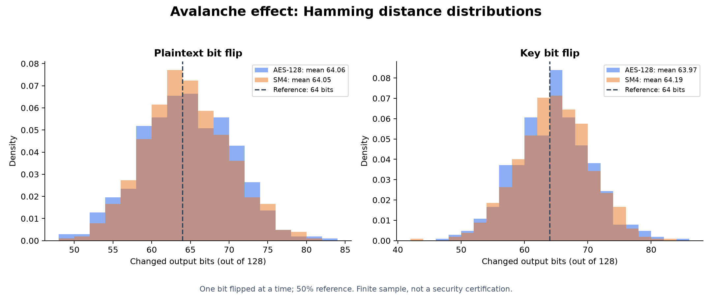
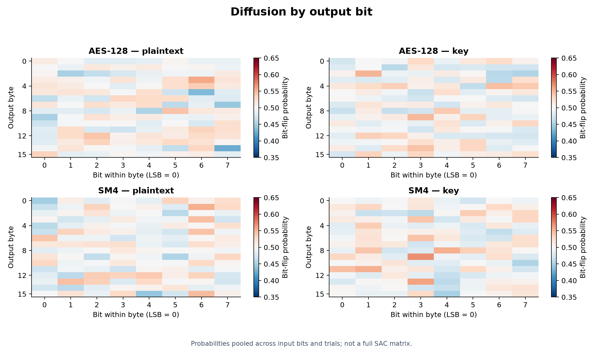
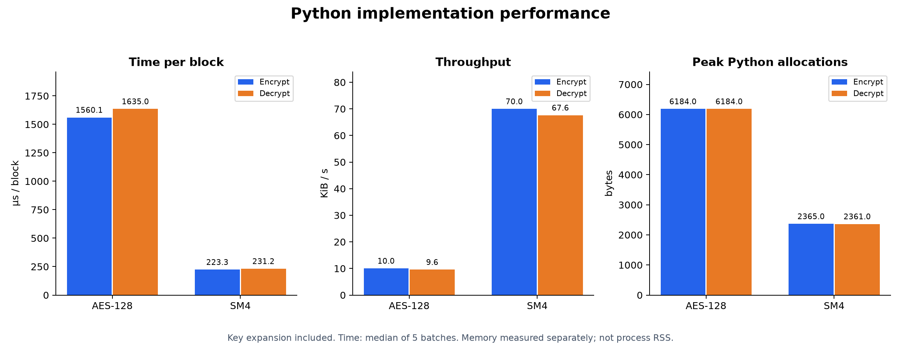
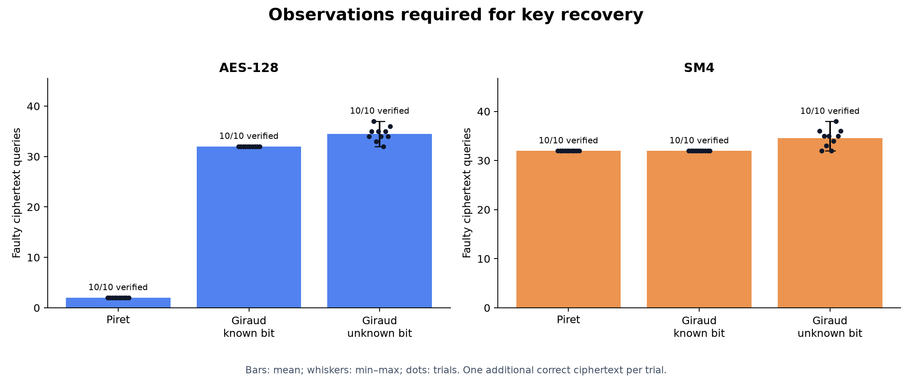
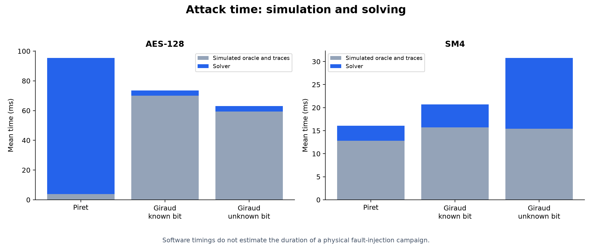
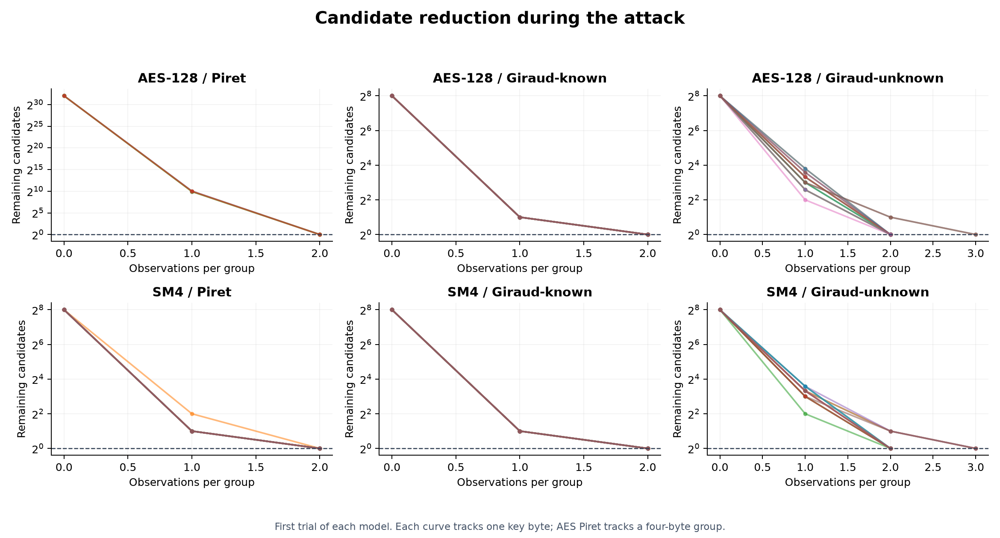
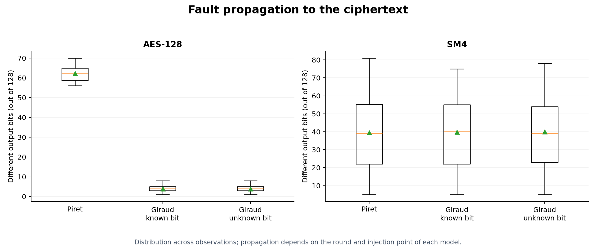

# Análise experimental — AES-128, SM4 e DFA

Resultados gerados por `python analysis/run_analysis.py`. Dados completos em `measurements.json`; amostras de avalanche em `avalanche.csv`.

Configuração: {'samples': 1024, 'avalanche_trials': 4, 'attack_trials': 10, 'seed': 20261108}. Ambiente: Windows-10-10.0.26200-SP0; Python 3.11.9.

## Algoritmos

| Métrica | AES-128 | SM4 |
|---|---:|---:|
| Vetor conhecido / round-trip | True / True | True / True |
| Avalanche do texto (% bits) | 50.047 | 50.037 |
| Avalanche da chave (% bits) | 49.974 | 50.148 |
| Entropia empírica (bits/byte) | 7.99022 | 7.98951 |
| Fração de bits 1 | 0.49809 | 0.49914 |
| Qui-quadrado bytes (255 graus de liberdade) | 223.12 | 237.72 |
| Monobit p aproximado | 0.1656 | 0.5325 |
| Uniformidade diferencial S-box | 4 | 4 |
| Não linearidade mínima S-box | 112 | 112 |
| Grau algébrico das componentes S-box | 7–7 | 7–7 |
| Cifrar (µs/bloco, mediana) | 1560.12 | 223.34 |
| Decifrar (µs/bloco, mediana) | 1634.99 | 231.16 |
| Cifrar (KiB/s) | 10.02 | 69.96 |
| Pico alocações Python ao cifrar (bytes) | 6184 | 2365 |

## Ataques

| Cifra | Modelo | Recuperações verificadas | Falhas média [mín–máx] | Tempo total médio (ms) | Solver sem oráculo (ms) |
|---|---|---:|---:|---:|---:|
| AES-128 | Piret | 10/10 | 2.00 [2–2] | 95.414 | 91.611 |
| AES-128 | Giraud-known | 10/10 | 32.00 [32–32] | 73.556 | 3.571 |
| AES-128 | Giraud-unknown | 10/10 | 34.50 [32–37] | 63.079 | 3.687 |
| SM4 | Piret | 10/10 | 32.00 [32–32] | 16.080 | 3.263 |
| SM4 | Giraud-known | 10/10 | 32.00 [32–32] | 20.687 | 4.954 |
| SM4 | Giraud-unknown | 10/10 | 34.60 [32–38] | 30.783 | 15.354 |

## Interpretação e limites

- Cada cifra tem bloco e chave de 128 bits: espaço nominal 2^128 e busca clássica média de aproximadamente 2^127 tentativas para chave uniforme. Isso não mede a entropia de um gerador de chaves. O PRNG com seed serve apenas à reprodução dos experimentos.
- Avalanche usa todos os 128 bits de entrada, um por vez, para cada texto/chave sorteado. A referência é 64 bits alterados (50%). Médias e probabilidades por bit não constituem um teste SAC completo nem prova de segurança.
- Estatísticas usam textos aleatórios sob uma chave fixa por cifra. Entropia próxima de 8 e p monobit não certificam aleatoriedade ou segurança; não foi executada a suíte NIST SP 800-22. Amostras finitas e testes múltiplos exigem cautela.
- DDT, espectro de Walsh, não linearidade e grau algébrico são exatos para a S-box de 8 bits. Não são limites de probabilidade para ataques à cifra completa nem uma criptoanálise linear/diferencial de todas as rodadas.
- AES Piret: XOR em um byte antes de MixColumns da rodada 8, máscaras 1–16; o solver recebe apenas saídas e desconhece máscara/linha. Giraud AES: bit antes de SubBytes da rodada 10, todos os 16 bytes. Known compartilha a máscara; unknown testa os oito bits possíveis.
- SM4: XOR na entrada da S-box, rodadas 31, 30, 29 e 28 (índices iniciando em zero), quatro bytes por rodada. Piret conhece a máscara e usa 1–8; Giraud usa oito máscaras de um bit, conhecido ou desconhecido. A recuperação completa exige acesso às quatro rodadas, retiradas com subchaves já recuperadas.
- As contagens incluem somente saídas falhas consultadas e há uma saída correta adicional por ensaio. Cada observação traz XOR implícito nas duas saídas, bits/bytes alterados e histórico de candidatos no JSON. Não há falhas descartadas, ruído ou tentativas físicas sem efeito neste modelo ideal.
- Taxa de sucesso é a proporção nos ensaios executados, sem garantia de generalização. Verifica-se igualdade da chave e recifragem. Casos ambíguos contam como falha de recuperação.
- Tempo inclui expansão de chave a cada bloco, cinco lotes após aquecimento, sem tracemalloc ativo. Memória é pico de alocações Python de uma chamada separada, não RSS, RAM de microcontrolador ou memória total do processo. Tempo do oráculo inclui instrumentação e traces; solver sem oráculo é a diferença dos tempos.
- Para blocos independentes, o trabalho cresce linearmente com a quantidade de blocos; o estado de cifra tem tamanho constante. Os tempos descrevem estas implementações didáticas em Python, sem comparação com AES acelerado. CPU por bloco está no JSON; ciclos/byte, energia, clock e tensão não foram medidos.
- Ponto lógico de injeção é conhecido no simulador. Janela temporal física, localização no chip, glitches de tensão/clock, laser e EM dependem de equipamento e calibração. Estes resultados não demonstram viabilidade física nem resistência a canais laterais.

## Referências primárias

- [NIST FIPS 197 — AES](https://doi.org/10.6028/NIST.FIPS.197-upd1)
- [RFC 8998 — uso de SM4](https://www.rfc-editor.org/rfc/rfc8998.html)
- Modelos e equações executados: `src/piret_aes.py`, `src/piret_sm4.py`, `src/giraud_aes.py` e `src/giraud_sm4.py`; documentação local em `docs/`.

<!-- generated-plots -->

## Plots

[Visual gallery](index.html) · [Complete PDF](analysis_charts.pdf)

### Avalanche effect: Hamming distance distributions

One bit flipped at a time; 50% reference. Finite sample, not a security certification.

### Diffusion by output bit

Probabilities pooled across input bits and trials; not a full SAC matrix.

### Python implementation performance

Key expansion included. Time: median of 5 batches. Memory measured separately; not process RSS.

### Observations required for key recovery

Bars: mean; whiskers: min–max; dots: trials. One additional correct ciphertext per trial.

### Attack time: simulation and solving

Software timings do not estimate the duration of a physical fault-injection campaign.

### Candidate reduction during the attack

First trial of each model. Each curve tracks one key byte; AES Piret tracks a four-byte group.

### Fault propagation to the ciphertext

Distribution across observations; propagation depends on the round and injection point of each model.

