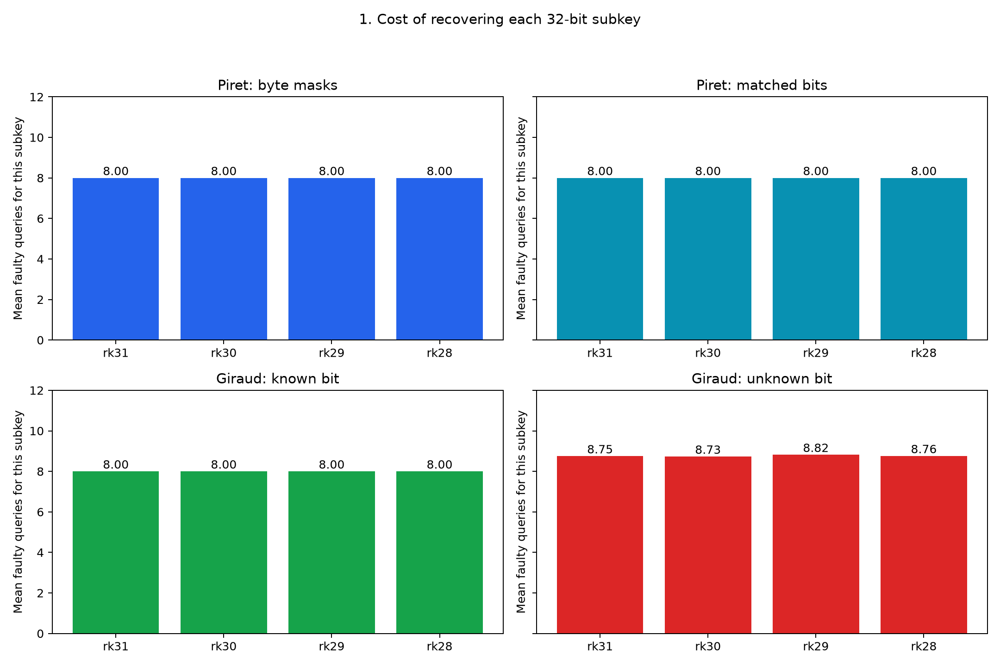
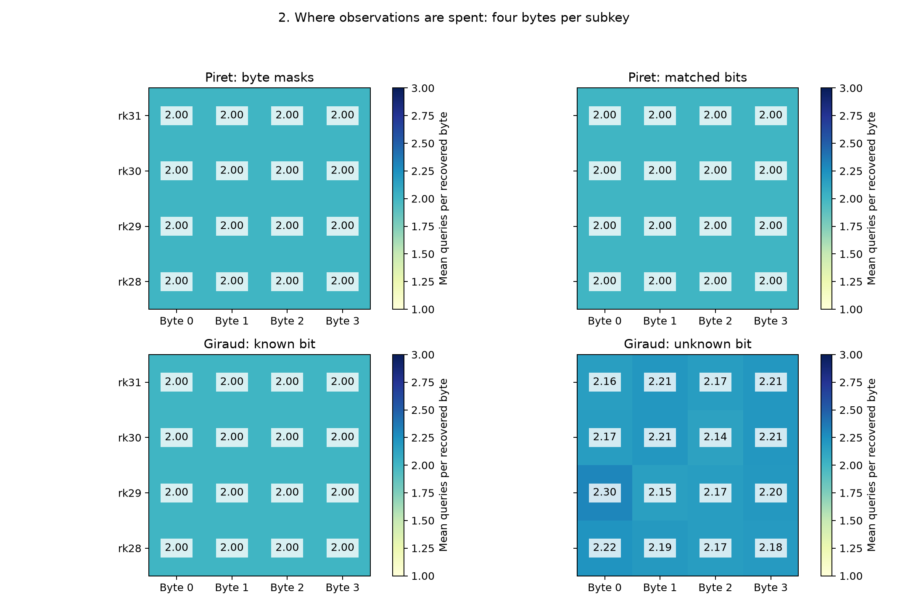
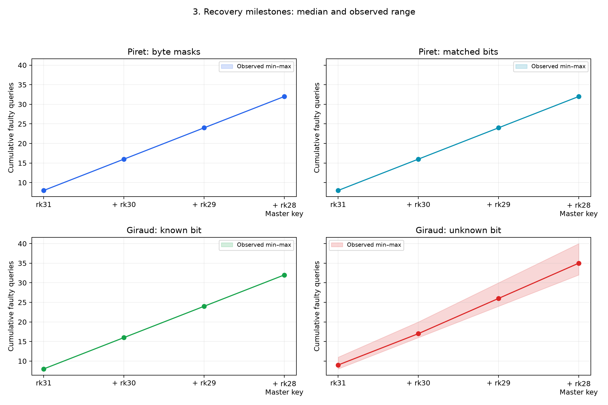
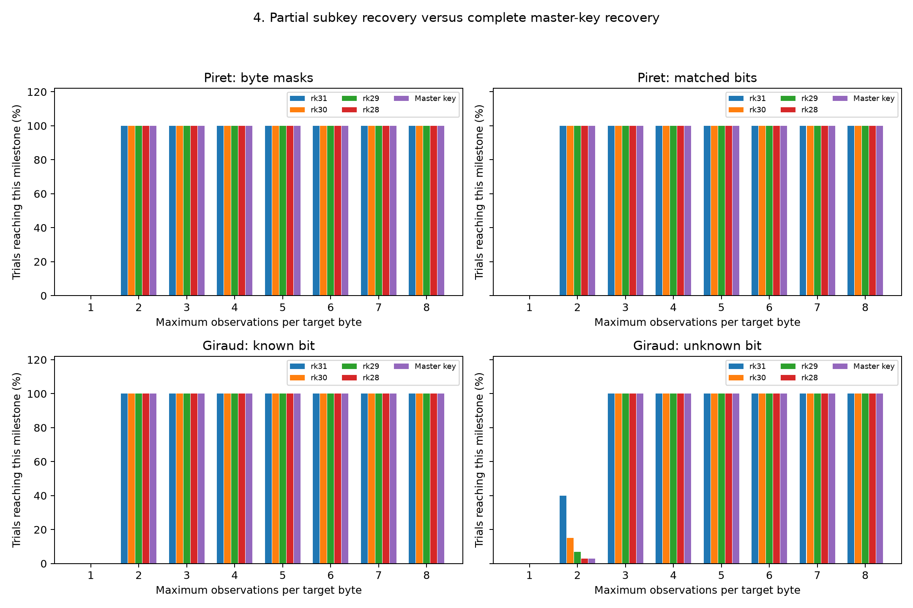

# SM4 subkey and master-key recovery analysis

These analyses reuse the saved paired experiments. No timing trial or target fault is rerun. Subkeys are reconstructed from singleton candidate intersections, not copied from the simulation key. The reference key is used afterwards for validation.

## Stage costs and recovery milestones

| Model | Subkey | Mean queries for this stage | Median cumulative queries | Cumulative range |
| --- | --- | --- | --- | --- |
| Piret-default | rk31 | 8.00 | 8 | 8–8 |
| Piret-default | rk30 | 8.00 | 16 | 16–16 |
| Piret-default | rk29 | 8.00 | 24 | 24–24 |
| Piret-default | rk28 | 8.00 | 32 | 32–32 |
| Piret-matched-bits | rk31 | 8.00 | 8 | 8–8 |
| Piret-matched-bits | rk30 | 8.00 | 16 | 16–16 |
| Piret-matched-bits | rk29 | 8.00 | 24 | 24–24 |
| Piret-matched-bits | rk28 | 8.00 | 32 | 32–32 |
| Giraud-known-bit | rk31 | 8.00 | 8 | 8–8 |
| Giraud-known-bit | rk30 | 8.00 | 16 | 16–16 |
| Giraud-known-bit | rk29 | 8.00 | 24 | 24–24 |
| Giraud-known-bit | rk28 | 8.00 | 32 | 32–32 |
| Giraud-unknown-bit | rk31 | 8.75 | 9 | 8–11 |
| Giraud-unknown-bit | rk30 | 8.73 | 17 | 16–20 |
| Giraud-unknown-bit | rk29 | 8.82 | 26 | 24–30 |
| Giraud-unknown-bit | rk28 | 8.76 | 35 | 32–40 |

## Figure 1: individual subkey cost



Each bar is the mean number of faulty outputs spent on one 32-bit subkey, excluding previous stages. Four bytes must become unique before that subkey is usable. Compare each round across model panels: extra unknown-bit cost comes from additional candidate ambiguity, not a longer key. Stage means are averaged over reached stages; the present dataset completes all stages in every trial.

## Figure 2: per-byte recovery cost



Rows identify the attacked subkey and columns its big-endian byte position. Each cell is the mean number of observations required for that byte. The color scale is shared across models. This locates where extra queries occur; small differences in this sample do not establish an intrinsically weaker byte position.

## Figure 3: cumulative recovery milestones



The line is the median cumulative cost and the shaded area the observed minimum–maximum, not a confidence interval. The known-mask variants reach their four subkeys at 8, 16, 24 and 32 queries in this dataset. rk31 must be recovered before peeling round 31 to attack rk30; the same dependency continues down to rk28. These are recovered subkey words, not successive 32-bit pieces of the master key. Only after all four tail subkeys are known does the inverse schedule produce the complete master key, with no additional faulty outputs.

## Figure 4: partial recovery under a restricted budget



At each per-byte budget, grouped bars show the percentage of trials reaching each subkey milestone and the master key. Early stages can succeed while a later byte remains ambiguous. A stage bar means all previous stages also completed because the solver stops at the first unresolved byte. The rk28 and master-key bars coincide because inverse expansion needs no further oracle calls once the four tail words are unique. Zero-height bars represent no completed milestone, not missing data. These restricted-budget results use the recorded histories and the same early-stop reconstruction validated in the comparison tests.

## Master-key and complete-schedule verification

The analysis rebuilds rk31, rk30, rk29 and rk28 from the singleton survivors in each history. It checks every extracted subkey against the independently generated reference schedule, reverses the schedule from those four words, and regenerates all 32 subkeys. It then checks the full master key, encryption and decryption. Ground truth is never used to decide between candidates.

| Model | Verified master keys | Matching regenerated schedule words |
| --- | --- | --- |

### Restricted budget example: two observations per byte

| Model | rk31 reached (%) | rk30 reached (%) | rk29 reached (%) | rk28 reached (%) | Master key (%) |
| --- | --- | --- | --- | --- | --- |
| Piret-default | 100 | 100 | 100 | 100 | 100 |
| Piret-matched-bits | 100 | 100 | 100 | 100 | 100 |
| Giraud-known-bit | 100 | 100 | 100 | 100 | 100 |
| Giraud-unknown-bit | 40 | 15 | 7 | 3 | 3 |

### Independently verified complete recoveries

| Model | Verified master keys | Matching regenerated schedule words |
| --- | --- | --- |
| Piret-default | 100/100 | 3200/3200 |
| Piret-matched-bits | 100/100 | 3200/3200 |
| Giraud-known-bit | 100/100 | 3200/3200 |
| Giraud-unknown-bit | 100/100 | 3200/3200 |

## Example: the first recorded trial

These random demonstration values are simulation secrets, not keys captured from a board.

| Model | rk31 | rk30 | rk29 | rk28 | Recovered master key |
| --- | --- | --- | --- | --- | --- |
| Piret-default | E92B3867 | 0ED8D71D | 04535080 | D02871D2 | 454C964C0D9306A542BA912C9351F990 |
| Piret-matched-bits | E92B3867 | 0ED8D71D | 04535080 | D02871D2 | 454C964C0D9306A542BA912C9351F990 |
| Giraud-known-bit | E92B3867 | 0ED8D71D | 04535080 | D02871D2 | 454C964C0D9306A542BA912C9351F990 |
| Giraud-unknown-bit | E92B3867 | 0ED8D71D | 04535080 | D02871D2 | 454C964C0D9306A542BA912C9351F990 |

## Reproduce

```powershell
python analysis/analyze_sm4_recovery.py
```

Outputs: `key_recovery.pdf`, `key_recovery.json`, `subkey_recovery.csv`, `partial_recovery.csv` and figures 04–07. TXT and colored HTML execution logs are overwritten on each run. These are controlled software experiments; physical fault reliability and acquisition time are not measured.
