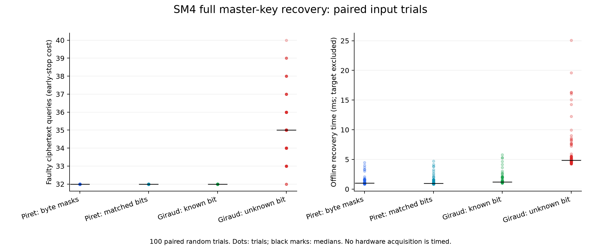
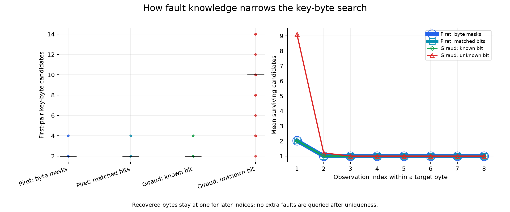

# SM4: controlled DFA versus Giraud-inspired filtering

## What is compared

All four variants recover rk31, rk30, rk29 and rk28 using controlled faults at S-box inputs, then reverse the SM4 schedule and remove FK. These are software models; no board measurements are included.

| Variant | Masks, in order | Solver knowledge |
| --- | --- | --- |
| Piret-default | 01, 02, 03, 04, 05, 06, 07, 08 | Exact byte mask |
| Piret-matched-bits | 01, 02, 04, 08, 10, 20, 40, 80 | Exact mask; single-bit observations |
| Giraud-known-bit | Same single-bit sequence | Exact selected bit |
| Giraud-unknown-bit | Same single-bit sequence | One-bit property, not the exact bit |

The SM4 variants are controlled DFA and a Giraud-inspired adaptation; they are not unchanged AES attacks. The default Piret sequence contains multi-bit masks, so its comparison with unknown-bit Giraud changes both observations and solver knowledge. The matched-bit control separates these effects.

## Measured results

100 paired random keys/plaintexts; seed 20261110. Each variant receives the same clean output and the same faulty output whenever it requests the same round/byte/mask.

| Model | Verified full recoveries | Faulty outputs: mean / median / range | Median first-pair candidates | Offline median (ms) |
| --- | --- | --- | --- | --- |
| Piret-default | 100/100 | 32.00 / 32 / 32–32 | 2 | 0.996 |
| Piret-matched-bits | 100/100 | 32.00 / 32 / 32–32 | 2 | 0.975 |
| Giraud-known-bit | 100/100 | 32.00 / 32 / 32–32 | 2 | 1.228 |
| Giraud-unknown-bit | 100/100 | 35.06 / 35 / 32–40 | 10 | 4.858 |

### Finite-sample success uncertainty

| Model | 95% Wilson interval for trial success |
| --- | --- |
| Piret-default | 96.30%–100.00% |
| Piret-matched-bits | 96.30%–100.00% |
| Giraud-known-bit | 96.30%–100.00% |
| Giraud-unknown-bit | 96.30%–100.00% |

## Interpretation

1. **Known-mask equivalence.** Piret-matched-bits and Giraud-known-bit have identical complete observation/candidate histories in every executed trial. They use equivalent S-box difference equations and the same round-peeling/schedule engine. Any timing difference measures Python implementation overhead, not a cryptographic advantage.

2. **Unknown-bit information loss.** For one fixed pair, the unknown-bit filter accepts an input if any of the eight masks explains the difference. Its candidate set contains the known-mask set. Intersections can therefore need more observations. This is reduced attacker knowledge, not a different SM4 key size.

3. **Paired observation cost.** Unknown-bit Giraud consumed a mean of 3.06 additional faulty outputs over known-bit Giraud on the same bit sequence (median difference 3). Ambiguous runs remain incomplete; the query count is not a successful full-key cost for them.

4. **Mask selection matters.** Piret-default and Piret-matched-bits differ only in their ordered mask sequence. A difference here is attributable to the chosen observations within this experiment; a different order may change the result.

5. **Budget curves.** The success plot uses a maximum number of distinct observations per byte. Curves are derived from the complete eight-mask run and respect early termination at the first ambiguous byte. They are checked against actual restricted-budget executions in tests. Low-budget failure counts do not represent complete attacks.

## Reading and comparing every graph

All figures use the same paired trials described above. Blue denotes Piret-default, cyan Piret-matched-bits, green Giraud-known-bit and red Giraud-unknown-bit. Equal plotted values are genuine equal results; no artificial offsets are added.

### Figure 1: faulty-output cost and offline recovery time



**Left panel: observations needed for recovery.** The horizontal axis identifies the four variants; the vertical axis counts faulty ciphertexts requested in one trial. Each dot is a trial and each black horizontal mark is the median. Repeated values overlap within a model, so visible dots do not count the number of trials. Consult the results table for sample size and range. A smaller value means fewer faulty outputs under this experiment's assumptions.

The three known-mask variants all use 32 faulty outputs in these trials: 16 target key bytes, with two observations per byte. Unknown-bit Giraud uses 32 to 40, averaging 35.06. Hiding the bit leaves more hypotheses, which sometimes requires another observation. The matched-bit Piret/Giraud comparison isolates this knowledge difference; the default Piret mask sequence is a separate control.

**Right panel: offline computation.** The horizontal axis again identifies the variants; the vertical axis is milliseconds measured on this computer. Dots show run-to-run variation and black marks show medians. This includes filtering, peeling and reversing the schedule, but excludes target encryption, physical acquisition and final validation. Compare these numbers as implementation costs, not as board attack times. Matched Piret and known-bit Giraud have identical candidate histories despite their different Python runtimes.

### Figure 2: observation budget, success and early termination


**Layout and axes.** Each model has its own row, with a success panel on the left and a consumed-query panel on the right. The horizontal axis is the maximum number of distinct observations allowed per target byte, not the total attack budget. The three known-mask models coincide numerically; separate rows make both Piret curves visible without changing any measurements.

**Left column: verified full-key recovery.** At budget one, all models fail to identify the entire key. At budget two, all three known-mask variants recover 100/100 keys; unknown-bit Giraud recovers only 3/100. At budget three, unknown-bit Giraud also reaches 100/100. A 100% sample result does not guarantee success for all keys or physical faults; see the Wilson intervals above.

**Right column: queries actually consumed.** At budget one, the median is one query because the solver stops at the first ambiguous byte. At budget two, known-mask variants consume 32 and complete recovery, whereas unknown-bit Giraud consumes a median of eight before usually stopping incomplete. Eight is therefore not a cheaper successful recovery than 32. From budget three onward, unknown-bit Giraud completes with median 35; known-mask variants remain at 32. Increasing the allowed budget does not force more queries after uniqueness.

**Comparison to explain aloud.** First compare success at a fixed budget; only then compare consumed queries together with completion status. Low cost on a failed attack measures early stopping, not efficiency at recovering a full key.

### Figure 3: candidate ambiguity and progressive elimination



**Left panel: candidates after the first pair.** Each dot is the candidate count for one target byte in one trial; the black mark is the median over all target bytes and trials. These are key-byte candidates, not complete 128-bit keys. The median is two for the known-mask variants and ten for unknown-bit Giraud. Knowing the bit supplies a more restrictive difference equation; knowing only that one bit flipped accepts the union of eight possibilities.

**Right panel: mean surviving candidates after intersections.** The horizontal axis is the observation index for a target byte; the vertical axis averages the remaining candidate count across target bytes and trials. Colors, line widths and nested hollow marker shapes expose coincident curves. Already recovered bytes stay at one for later plotted indices; these extended points do not represent additional oracle requests. A mean near one does not prove every byte is unique: the full-key success plot in Figure 2 answers that question.

**Connection between the figures.** More initial hypotheses in Figure 3 explain why unknown-bit Giraud needs extra observations in Figure 1 and a larger per-byte budget in Figure 2. The matched-bit known-mask variants have identical histories, so these graphs support equivalence under matched assumptions rather than an intrinsic advantage attached to an attack name.

## Practical example: first byte of rk31

For plaintext and key `0123456789ABCDEFFEDCBA9876543210`, a round-31 byte-0 fault with mask `01` yields inverse-L byte difference `4F` and known byte q=`07`.

- Piret with known mask and Giraud with known bit both retain key candidates `90 91`.
- Giraud with unknown bit retains `19 1B 6A 89 90 91 A0 B0 C9 EA`.
- More compatible candidates mean less information from this observation. No reference key is used to choose a survivor.

## Method and limits

- Candidate computation uses the real `src/piret_sm4.py` and `src/giraud_sm4.py` functions. All target outputs are precomputed once per trial; the solver sees only ciphertexts and permitted fault descriptors.
- The maximum budget is eight distinct masks per target byte. A clean reference encryption is additional to every reported faulty-output cost.
- Offline time includes candidate filtering, history construction, dictionary oracle lookups, peeling and inverse expansion. It excludes target encryption, USB/serial traffic, glitch calibration, output collection and final verification. This isolates host-side recovery work; it is not physical attack duration.
- The inverse-L matrix is warmed before timing. Model order is rotated across trials. No verbose terminal/GUI lessons are included in timed calls.
- The 95% Wilson interval describes sample success across these seeded software trials; it is not a measured physical success probability. Candidate observations within a trial are dependent and are not treated as independent success trials.
- Exact round/byte access is shared by all variants. Piret additionally knows byte magnitude; unknown-bit Giraud knows the single-bit restriction. Physical faults may fail these assumptions or produce resets, wrong locations, multi-bit corruption or no effect.
- All claimed full recoveries are checked against simulation ground truth, re-encryption and decryption. The target key is used only to construct/validate the experiment, not as solver input.

## Reproduce and inspect

```powershell
python analysis/compare_sm4_attacks.py --trials 100 --seed 20261110
```

`measurements.json` contains every event and source hashes; `trials.csv` summarizes paired measurements. `comparison.pdf` and `figures/` contain the plots. The executable also saves TXT/HTML logs. New runs replace this comparison's outputs.

## Suggested statement for the presentation

> Under the same controlled single-bit observations and exact-mask knowledge, the two SM4 implementations recover the same candidates. When the exact bit is hidden, Giraud-inspired filtering retains more hypotheses and can require more observations. The comparison therefore measures the effect of fault information and mask selection, not a physical break of an STM32 implementation.
